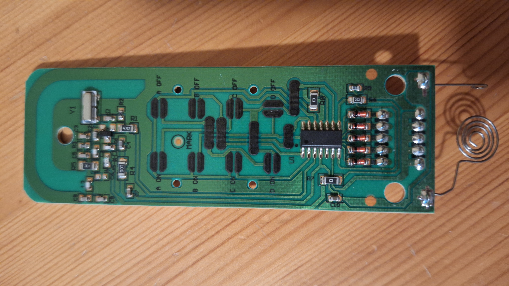

# AlexaControlledESP

This project enables Amazon Alexa voice control of 433MHz smart plugs through an ESP8266 microcontroller. The ESP8266 emulates Philips Hue devices, allowing Alexa to discover and control 4 individual smart plugs wirelessly.

## 🎯 Project Overview

The system consists of:
- **ESP8266** microcontroller (ESP-12E module)
- **8 relays** controlled by the ESP8266 GPIO pins
- **433MHz remote control** operated by the relays
- **4 smart plugs** operating on 433MHz frequency
- **fauxmoESP library** for Alexa integration

The ESP8266 connects to your WiFi network and appears as Philips Hue devices to Alexa. When you give voice commands, the ESP8266 activates relays that physically press the buttons on the 433MHz remote, controlling the smart plugs.

## 📋 Prerequisites

- **Hardware:**
  - ESP8266 development board (ESP-12E module) - [Datasheet](esp8266_ch340_micro_usb_interface.pdf) *(example for a board that matches the specifications for the project)*
  - 8x relays (5V or 3.3V compatible)
  - 433MHz remote control for your smart plugs *(example shown below)*
  
      
      
      *This is an example of how your 433MHz remote might look. Your remote may have different labeling or design, but should have separate ON/OFF buttons for each channel (A, B, C, D).*

  - Jumper wires for connections
  - USB cable for programming
  - Breadboard or PCB for connections

- **Software:**
  - [Visual Studio Code](https://code.visualstudio.com/)
  - [PlatformIO extension](https://platformio.org/install/ide/vscode) for VS Code
  - Amazon Alexa device (Echo, Dot, etc.) or Alexa app

## 🔧 Hardware Setup

### Pin Configuration
The ESP8266 is connected to 8 relays that control the 433MHz remote with the following pin mapping:

| Device       | ON Relay Pin | OFF Relay Pin | Remote Button |
| ------------ | ------------ | ------------- | ------------- |
| Smart Plug A | D0           | D1            | A ON / A OFF  |
| Smart Plug B | D2           | D3            | B ON / B OFF  |
| Smart Plug C | D4           | D5            | C ON / C OFF  |
| Smart Plug D | D6           | D7            | D ON / D OFF  |

**Note:** Each smart plug requires 2 relays - one for the ON button and one for the OFF button on the 433MHz remote.

### Wiring
1. Connect each ESP8266 GPIO pin to the control input of its corresponding relay
2. Connect each relay's output contacts to the corresponding button on your 433MHz remote:
   - Relay connected to D0 → Remote's "A ON" button
   - Relay connected to D1 → Remote's "A OFF" button
   - Relay connected to D2 → Remote's "B ON" button
   - And so on...
3. Ensure proper ground connection between ESP8266 and the relays
4. Power the ESP8266 via USB or external 3.3V supply
5. Power the relays according to their specifications (usually 5V or 3.3V)
6. Each relay should be wired as a normally open (NO) switch across the remote button contacts

## 🚀 Installation & Software Setup

### 1. Clone the Repository
```bash
git clone https://github.com/boettgi14/AlexaControlledESP.git
cd AlexaControlledESP
```

### 2. Configure WiFi Credentials
1. Copy `src/credentials.sample.h` to `src/credentials.h` (if not already present)
2. Edit `src/credentials.h` with your WiFi details:
```cpp
#define WIFI_SSID "Your_WiFi_Network"
#define WIFI_PASS "Your_WiFi_Password"
```

### 3. Build and Upload
#### Using PlatformIO in VS Code
1. Open Visual Studio Code
2. Install the PlatformIO extension if not already installed
3. Open the project folder in VS Code
4. PlatformIO will automatically install dependencies
5. Connect your ESP8266 via USB
6. Click the PlatformIO icon in the sidebar
7. Under "PROJECT TASKS" → "esp12e":
   - Click "Build" to compile the project
   - Click "Upload" to flash the ESP8266
   - Click "Monitor" to view serial output

### 4. Device Discovery
1. After successful upload, the ESP8266 will connect to your WiFi
2. Open the Alexa app on your phone
3. Go to **Devices** → **Add Device** → **Light** → **Other**
4. Alexa will discover 4 new devices:
   - "Steckdose A" (Smart Plug A)
   - "Steckdose B" (Smart Plug B)  
   - "Steckdose C" (Smart Plug C)
   - "Steckdose D" (Smart Plug D)

## 🗣️ Voice Commands

Once set up, you can control your smart plugs with these voice commands:

```
"Alexa, turn on Steckdose A"
"Alexa, turn off Steckdose B"
"Alexa, switch on Steckdose C"
"Alexa, switch off Steckdose D"
```

You can also rename the devices in the Alexa app to more friendly names like "Living Room Lamp" or "Coffee Maker".
## 🔍 Troubleshooting

### ESP8266 Won't Connect to WiFi
- Check WiFi credentials in `credentials.h`
- Ensure your router supports 2.4GHz (ESP8266 doesn't support 5GHz)
- Monitor serial output for connection status

### Alexa Can't Discover Devices
- Ensure ESP8266 and Alexa device are on the same network
- Try saying "Alexa, discover devices"
- Restart the ESP8266 and try discovery again
- Check that port 80 is not blocked on your network

### Smart Plugs Don't Respond
- Verify wiring connections between ESP8266 and relays
- Check relay connections to the 433MHz remote buttons
- Test the remote manually to ensure it works
- Ensure relays are receiving proper power supply
- Check if the smart plugs are in pairing/learning mode
- Adjust signal timing in the code if needed

### Memory Issues
- Monitor free heap in serial output
- The code includes heap monitoring every 5 seconds
- Consider reducing the number of devices if memory is limited

## 📚 Libraries Used

- **[fauxmoESP](https://github.com/vintlabs/fauxmoESP)** - Amazon Alexa support for ESP8266/ESP32
- **[ESPAsyncTCP](https://github.com/me-no-dev/ESPAsyncTCP)** - Asynchronous TCP library for ESP8266
